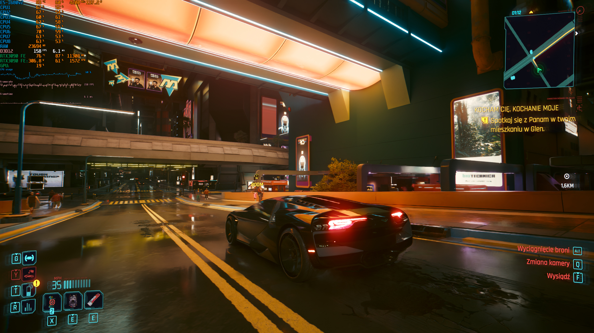

# MFGAmpereUnlock

Enables native NVIDIA DLSS Frame Generation / Multi Frame Generation on **Ada,
Ampere, and Turing** GPUs through a ReShade/RenoDX addon. Supports a wide range
of DLSS-G and Streamline versions without requiring a specific DLL combination.

<p align="center">
  <a href="docs/media/ampere-screenshot.jpg">
    
  </a>
</p>

The addon makes changes in game memory; it does not modify or redistribute
NVIDIA DLLs. Close the game before updating the addon.

## Usage

1. Install [ReShade](https://reshade.me/) with addon support, or the appropriate
   [RenoDX](https://github.com/clshortfuse/renodx) mod for the game.
2. Download the [latest release](../../releases/latest).
3. Place `renodx-mfgunlock.addon64` in the ReShade addon location used by the
   game, commonly next to the game executable. A game-specific RenoDX package
   may use its own addon folder.
4. **Append the following to `ReShade.ini`:**

   ```ini
   [ADDON]
   LoadFromDllMain=renodx-mfgunlock.addon64
   ```

   **If omitted, MFG Unlock will append itself automatically on supported
   ReShade versions; restart the game once afterwards for MFG to be detected.**
5. Start with the game's original DLSS-G and Streamline libraries. **You do not
   need to replace them with the latest versions for MFG Unlock to work.** Newer
   versions are recommended for advanced features. You can find the
   [latest DLSS-G DLL](https://www.techpowerup.com/download/nvidia-dlss-3-frame-generation-dll/)
   on TechPowerUp.
6. MFG Unlock supports **Streamline 1.x and 2.x** without requiring a
   specific Streamline/DLSS-G version pair. For newer NVIDIA features,
   [Streamline 2.14.1 with DLSS-G 310.9.1](https://www.nexusmods.com/site/mods/1282?tab=files)
   is an optional update where the game supports it, not a requirement.
   **Do not replace Streamline 1.x with 2.x** in older games such as
   **A Plague Tale: Requiem**.
7. Use the game's multiplier selector when available. Otherwise use **Force frame
   multiplier** in the ReShade **MFG Unlock** panel.

The MFG Unlock panel shows the available multiplier information and warns if
an option exceeds the reported maximum, without blocking the selection.

### Dynamic MFG

Dynamic MFG lets NVIDIA adjust the frame multiplier to reach your target FPS.
Use **0** for Auto (display refresh rate), or enter an FPS target. If a change
is not picked up, toggle Frame Generation off and on in the game's menu.

### Frame Generation Presets A/B/C

Choose **Application / driver default**, **Preset A**, **Preset B**, or
**Preset C**. Presets affect only the running game, not NVIDIA App or driver
profiles. The panel shows the active preset when reported by the NVIDIA library.
Restart the game if a preset change is not picked up.

### HUD and UI artifact reduction (UI Recomposition)

**UI Recomposition** helps reduce ghosting and distortion of HUD elements in
generated frames by handling the game scene and UI separately. **Automatic UI
Composition** is enabled by default and uses the game's HUD-less/UI buffers when
available. On D3D12, **Inject detected UI for DLSS-G** can supply a suitable UI
buffer when the game does not tag one itself. If menus or HUD elements look wrong,
try disabling that injection while leaving Automatic UI Composition enabled.

### Image quality improvements on thin geometry

DLSS-G generates intermediate frames by predicting movement and shifting image
details to their estimated positions (*warping*). Thin structures such as
fences, wires and foliage, along with moving outlines, can be difficult to
reconstruct consistently. Generated frames may then show flicker, broken
details, ghosting or stretched edges. These optional settings address
different parts of that process:

- **Validated Warp Blend** - checks whether warped image details are reliable
  before blending them into a generated frame, helping keep thin structures and
  moving edges more consistent. **Enable it** when fine geometry flickers or
  outlines break apart during camera movement. **Off** keeps NVIDIA's normal
  blending; if On creates more trails or ghosting, turn it back off. This
  feature works independently of ISR and BAM. The **Warp blend mode** selector
  defaults to Validated Warp; **Blackwell baseline** retargets NVIDIA's original
  blending without the VWB change, while **Redirect control** tests shader-data
  redirection without changing the blending algorithm.
- **Intermediate Scatter Retention (ISR)** - preserves more motion detail in thin
  or fast-moving objects that might otherwise break apart in generated frames.
  This can also cause trails, color bleeding or stretched silhouettes near
  object boundaries. Toggle ISR **On/Off** to compare the result; it requires
  **Temporal Fix** to be enabled.
- **Boundary Artifact Mitigation (BAM)** - adjusts ISR near object edges using
  neighboring motion and depth information:
  - **Off** - original ISR behavior, with no additional boundary protection.
  - **Balanced** - retains fine details where nearby pixels agree, while easing
    ISR at uncertain edges. A good starting point.
  - **Aggressive** - requires stronger agreement before retaining motion detail,
    prioritizing cleaner boundaries if Balanced still leaves trails, potentially
    at the expense of some fine detail.

**BAM only affects ISR when ISR is enabled.** Restart the game after changing
these quality settings.

### SDR and HDR

The addon detects SDR/HDR output and handles the corresponding color spaces and
UI resources.

### Vulkan

Supports native DLSS-G/MFG, including Dynamic MFG, in Vulkan games through NVIDIA
NGX. Vulkan-specific fixes improve ReShade addon initialization, recognition of
renamed Streamline components, and HUD/UI resource handling.

## Game compatibility

*Games confirmed working with MFGAmpereUnlock:*

| Game | Working | Comment |
| --- | --- | --- |
| A Plague Tale: Requiem | Yes | Legacy Streamline 1.x; do not replace with Streamline 2.x |
| Alan Wake 2 | Yes | |
| Assetto Corsa Rally | Yes | |
| Clair Obscur: Expedition 33 | Yes | |
| Control Resonant | Yes | |
| Cyberpunk 2077 | Yes | Dynamic MFG, Validated Warp Blend and Preset B (tested with Streamline 2.14.1 / DLSS-G 310.9.1) |
| Grand Theft Auto V Enhanced | Yes | |
| Hogwarts Legacy | Yes | |
| Indiana Jones and the Great Circle | Yes | Vulkan; add `+r_allowBlackListedLayers 1` to the game launch options to load ReShade |
| JDM: Japanese Drift Master | Yes | |
| Portal with RTX | Yes | RTX Remix |
| Red Dead Redemption 2 | Yes | PureDark Frame Generation mod |
| The Witcher 3: Wild Hunt — Remastered | Yes | |

*So far, I haven't encountered a game that doesn't work with MFG Unlock.
Try it in other DLSS Frame Generation titles and share
what you find!*

## Requirements

- GeForce RTX 20-, 30-, or 40-series GPU.
- ReShade with addon support.
- A game with NVIDIA DLSS Frame Generation through Streamline or NGX.

## Settings

Settings are stored under `[RenoDX.MFGUnlock]` in `ReShade.ini`.

Most multiplier, Dynamic MFG and UI controls update in-game. Warp Blend, ISR
and Boundary Artifact Mitigation changes require a restart.

| Key | Default | Meaning |
| --- | --- | --- |
| `Enabled` | `1` | Enables the addon |
| `Architecture` | `Auto` | `Auto`, `Ada`, `Ampere` or `Turing` |
| `MaxCount` | `4` | Reported `DLSSG.MultiFrameCountMax`; `0` preserves the native value |
| `ForceMultiplier` | `0` | `0` follows the game; `2`-`6` requests the selected multiplier |
| `DynamicMFG` | `0` | Enables native Dynamic MFG; takes priority over `ForceMultiplier` |
| `DynamicTargetFPS` | `0` | `0` = Auto (display refresh); accepts decimal FPS targets |
| `FrameGenerationPreset` | `0` | `0` default, `1` A, `2` B, `3` C |
| `TemporalFix` | `1` | Corrects generated-frame temporal positions |
| `ValidatedWarpBlend` | `0` | Enables Validated Warp Blend; restart required |
| `IntermediateScatterRetention` | `0` | Enables ISR; restart required |
| `BoundaryArtifactMitigationMode` | `0` | `0` Off, `1` Balanced, `2` Aggressive; restart required |
| `UIComposition` | `1` | Enables automatic HUD/UI recomposition |
| `UICandidateInjection` | `1` | Detects and supplies compatible UI buffers on D3D12 |
| `RuntimeSelectionMode` | `0` | `0` game default, `1` prefer local Streamline, `2` NVIDIA OTA; restart required |
| `ForceFlipMeteringOff` | `0` | Legacy software pacing workaround; restart required |
| `ShowDebugOptions` | `0` | Shows advanced/diagnostic controls |
| `WarpDiagnosticMode` | `2` | Warp blend mode: `2` Validated Warp, `1` retargeted NVIDIA baseline, `0` redirect-only test |

## Troubleshooting

### The addon does not appear in ReShade

- Use ReShade with full addon support and check the game's addon folder.
- Check `ReShade.log` for addon loading or API-version errors.

### The game only offers Auto/2x, or a multiplier is not applied

- Toggle Frame Generation off and on after opening the graphics menu.
- Check the **MFG Unlock** panel and the loaded `nvngx_dlssg.dll` version.

### Higher multipliers freeze or cause poor pacing

- Normally leave `ForceFlipMeteringOff=0`. If the game freezes specifically at
  higher multipliers, try `ForceFlipMeteringOff=1` and restart.

## How it works

MFGAmpereUnlock uses NVIDIA's native DLSS Frame Generation rather than a
replacement frame generator:

1. **On Ada**, DLSS-G already contains compatible `sm_89` code, so the addon
   adjusts Frame Generation availability and MFG settings.
2. **On Ampere and Turing**, the addon adapts compatible NVIDIA CUDA/PTX code
   to `sm_86` and `sm_75`, respectively, for compilation by the NVIDIA driver
   (JIT). Existing compatible code is used when available.
3. **Temporal Fix** keeps generated frames correctly spaced at higher
   multipliers; **Dynamic MFG** uses NVIDIA's native FPS targeting.
4. **Validated Warp Blend**, **Intermediate Scatter Retention** and
   **Boundary Artifact Mitigation** improve image quality, while **UI
   Recomposition** keeps HUD elements separate from generated frames when
   compatible resources are available.

## Building from source

MFGAmpereUnlock is built through RenoDX. You need **Visual Studio 2022** with
the **Desktop development with C++** workload, **CMake**, and **Git**.

From the MFGAmpereUnlock repository root, run:

```powershell
.\tools\build_mfgunlock.ps1
```

On the first run, the helper automatically downloads the pinned RenoDX and NVAPI
source dependencies into `external\RenoDX`, initializes RenoDX submodules, and
sets up the repo-local shader compiler tools required by the build. System-wide
prerequisites such as Visual Studio and the Windows SDK are not installed automatically.

The compiled addon is written under:

```text
dist\mfgunlock\reshade-api18\renodx-mfgunlock.addon64
```

To build for any ReShade API version available in upstream ReShade history, pass the API number directly. Older API versions can be useful for compatibility with legacy ReShade releases required by some closed-source mods, such as PureDark mods:

```powershell
.\tools\build_mfgunlock.ps1 -ReShadeApi 15
.\tools\build_mfgunlock.ps1 -ReShadeApi 14,15,17,18,20
```

The helper resolves the matching ReShade source revision automatically, detects the callback ABI from those headers and keeps every per-API ReShade checkout inside the repository at `external\reshade-api\api<version>`. API-specific builds are written to `dist\mfgunlock\reshade-api<version>\`. At the end of a build the helper prints the complete absolute path and SHA256 for every generated addon. If the requested API never existed upstream, the build stops with a clear error.

To re-check and refresh the managed build dependencies, use `-RefreshDependencies`.

## Credits

- [dashdogy / RTX40MFG-Unlock](https://github.com/dashdogy/RTX40MFG-Unlock) - the original MFG unlock and ASI implementation, including the temporal fix for higher multipliers ([MIT License](https://github.com/dashdogy/RTX40MFG-Unlock/blob/main/LICENSE)).
- [Dreamt](https://github.com/ImDreamt) - brought the original unlock to ReShade/RenoDX.
- [mavismmg](https://github.com/mavismmg) - developed and maintained [MFGAdaUnlock-RenoDx](https://github.com/mavismmg/MFGAdaUnlock-RenoDx), with broader runtime compatibility, Dynamic MFG, Vulkan and image-quality features later adapted here.
- Tony Joaca (DLSSG-Transfusion) - published the `qualityValidWarp` research that informed MFGAdaUnlock's Validated Warp Blend implementation.
- [Coldwood1026](https://github.com/Coldwood1026) - shared DLSS-G PTX (`ptx_out.zip`) and demonstrated compilation for Ampere (`sm_86`) and Turing (`sm_75`), helping start the backport.
- [mugensc](https://next.nexusmods.com/profile/mugensc) - tested compatibility with RenoDX DLSS5 and identified a working runtime combination.
- [RenoDX](https://github.com/clshortfuse/renodx) by clshortfuse and [ReShade](https://github.com/crosire/reshade) by crosire - the projects this addon is built on.

## Disclaimer

Not affiliated with or endorsed by NVIDIA. This modifies process memory of a
running game. Use it at your own risk; anti-cheat systems may object to injected
addons or modified process memory.

## License

MIT — see [LICENSE](LICENSE).
